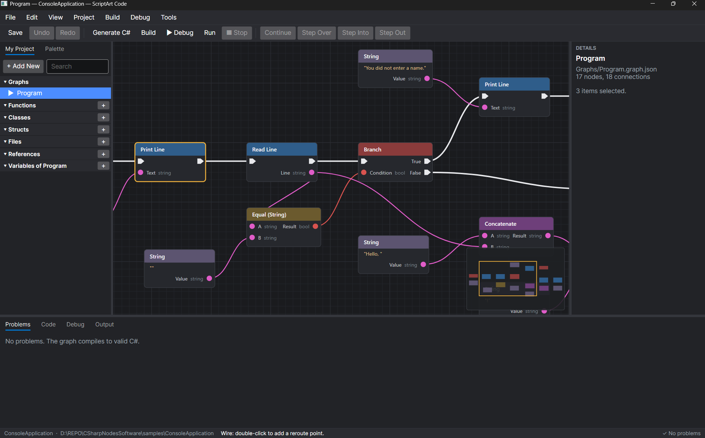
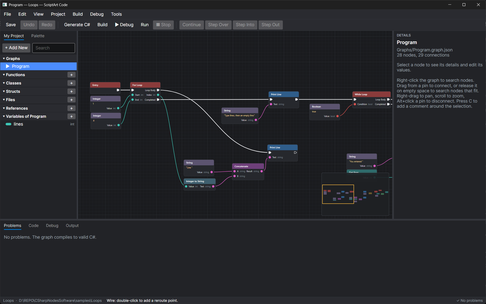
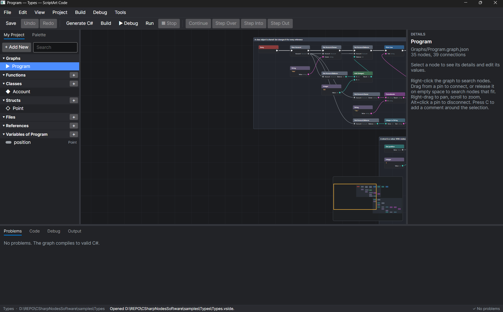
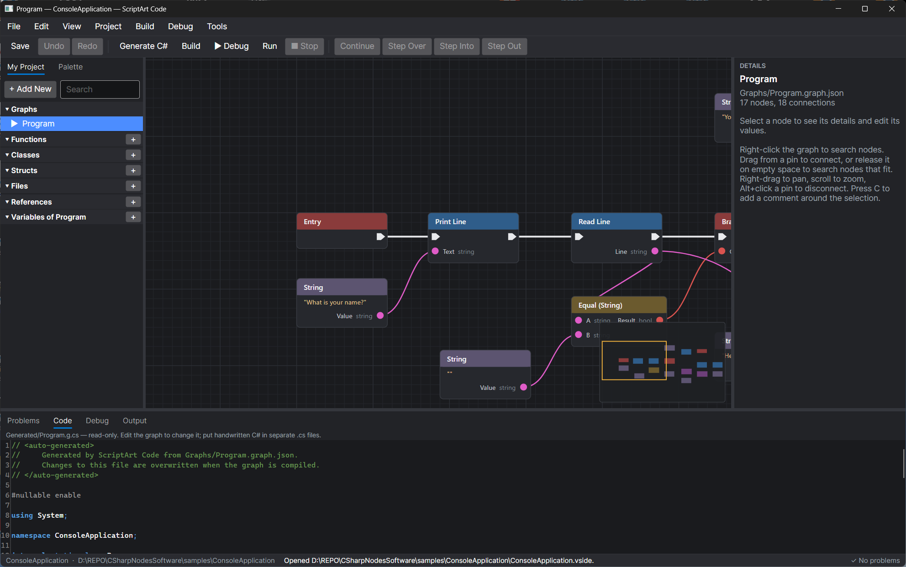

<div align="center">

# ScriptArt Code

**Draw your program. Get real C#.**

A visual programming IDE for .NET 10: connect nodes on a canvas, and a real compiler turns them into clean, readable C# you own.

[](LICENSE)
[](https://dotnet.microsoft.com/)
[](https://github.com/Diginaat/scriptart-code/releases)




</div>

## Why ScriptArt Code

<table>
<tr>
<td width="33%" valign="top">

### 🎨 See your logic

Every step of your program is a node, every value a colored wire. Types have colors, so a string never plugs into a number by mistake.

</td>
<td width="33%" valign="top">

### ⚙️ Real code, not a toy

Graphs compile to ordinary C# with `if`, loops, classes, and `async`. No interpreter, no runtime library: open the result in any .NET editor.

</td>
<td width="33%" valign="top">

### 🛡️ Safe to explore

Live checks flag mistakes on the node itself, unlimited undo, and nothing is written until you have seen the diff.

</td>
</tr>
</table>

**Visual graph → compiler → clean C# → `dotnet build` → your standalone app.**

## A tour

### Loops, variables, and branches

Build with For and While loops, Branch, Break and Continue. The minimap (lower right) keeps big graphs easy to move around.



### Classes, structs, and methods

Add your own types in **My Project**, give them properties, methods, and constructors, and use them as nodes. Comments group related nodes and explain what they do.



### The C# it writes

The **Code** tab shows the generated C# as you edit, mapped back to the nodes it came from. It is the same code that ships, readable enough to hand to a teammate.



For the graph at the top, that is:

```csharp
internal static class Program
{
    public static void Main()
    {
        Console.WriteLine("What is your name?");
        string line = Console.ReadLine() ?? "";
        if (line == "")
        {
            Console.WriteLine("You did not enter a name.");
            return;
        }

        Console.WriteLine("Hello, " + line + "!");
        Console.WriteLine("Goodbye.");
    }
}
```

## What you can build with it

| | |
| --- | --- |
| 🧩 **Building blocks** | Variables, lists and dictionaries, loops, functions with parameters and return values, try/catch, classes, structs, generics, `async`/`await` |
| 📦 **The whole .NET world** | Call methods of .NET types, NuGet packages, and referenced projects as nodes |
| ✍️ **Code where you want it** | Handwritten `.cs` files beside your graphs, checked as you type |
| 🐞 **Debugging on the canvas** | Breakpoints on nodes (F9), step through (F10/F11), see the call stack and variables |
| 🔍 **Find your way** | Go to Definition (F12), command palette (Ctrl+Shift+P), node search that understands everyday words and typos |
| 🔌 **Extensible** | Node libraries from others, loaded only after you approve them ([how to write one](docs/NODE_AUTHORING.md)) |
| 🤖 **Scriptable** | `vside generate`, `diff`, `build`, `run`, and `migrate` for scripts and CI |

## Get started

### Download

Grab the latest build for Windows, Linux, or macOS from **[Releases](https://github.com/Diginaat/scriptart-code/releases)**, unpack it, and start `ScriptArtCode`. No .NET install is needed to start the IDE; to build and run your programs, install the [.NET 10 SDK](https://dotnet.microsoft.com/download).

> The builds are not code-signed yet, so Windows SmartScreen and macOS Gatekeeper may ask for confirmation the first time.

### Your first program in a minute

1. **File → New Project**, pick a folder.
2. **Right-click** the canvas, type `print`, and add **Print Line**.
3. Drag from **Entry**'s white arrow to **Print Line**.
4. Drag from Print Line's pink **Text** pin onto empty space, pick **String**, then double-click its value and type `Hello!`.
5. Press **Ctrl+F5** to run it. The output appears in the **Output** tab.

Or open one of the ten [samples](samples): HelloWorld, ConsoleApplication, Variables, Loops, Functions, Exceptions, Collections, Types, Dictionaries, Methods.

### From source

```sh
dotnet build ScriptArtCode.slnx
dotnet run --project src/ScriptArt.App -- samples/HelloWorld/HelloWorld.vside   # the IDE
dotnet run --project src/ScriptArt.Cli -- run samples/ConsoleApplication/ConsoleApplication.vside
dotnet test ScriptArtCode.slnx
```

The samples also build without the IDE: `cd samples/HelloWorld && dotnet run`.

<details>
<summary><b>Packaging your own release</b></summary>

```sh
eng/package.sh win-x64 linux-x64 osx-arm64      # or: pwsh eng/package.ps1 -Runtimes win-x64
dotnet tool install -g --add-source artifacts/packages ScriptArt.Cli
```

This produces the self-contained IDE per runtime, the `vside` CLI as a .NET tool, and the node SDK packages in `artifacts/`.

</details>

<details>
<summary><b>⌨️ Editor controls</b></summary>

| Action | Input |
| --- | --- |
| Add a node | Right-click empty space on the graph and search the action menu, or drag from the Palette tab onto the graph |
| Context sensitivity | The action menu's **Context Sensitive** box (on by default) shows only nodes that fit: from a released wire or a selected node, nodes that can connect to it, wired up when added. Clear it to see every node |
| Add a connected node | Drag a wire from a pin and release on empty space, then pick from the compatible nodes |
| Connect | Drag from a pin to a compatible pin (either direction) |
| Disconnect | Alt+click a pin |
| Move / select | Drag a node; Ctrl+click toggles; drag on empty space box-selects |
| Pan / zoom | Right- or middle-drag; mouse wheel |
| Align or distribute | Select items, then Edit → Arrange (align edges or centers; space three or more evenly) |
| Connect from the keyboard | Select two nodes, press Ctrl+L (Edit → Connect Pins…), pick a connection or a wire to remove, Enter |
| Loops | While Loop and For Loop (Flow category): Loop Body runs each iteration, Completed runs afterwards. Break and Continue work inside a body |
| My Project panel | Lists the graphs, functions, classes, structs, and the open graph's variables in collapsible sections, each with a **+** button; **+ Add New** offers all of them. Click a graph to open it |
| Variables | **+** next to Variables; select a variable to edit its name, type, and initial value in Details. Drag it onto the graph for a Get (hold Ctrl) or Set (hold Alt) node, or pick one from the menu |
| Classes and structs | **+** next to Classes or Structs; add properties in Details. New, Get, and Set (class) or With (struct) nodes appear under Types |
| Methods | **Add Method** in a class's or struct's Details; use its **Self** node inside the method and its Call node, with a Target, elsewhere |
| Lists and dictionaries | Choose a type such as `List<Point>` or `Dictionary<string, int>` for a variable, parameter, or property; its nodes appear under Lists or Dictionaries |
| Constructors and generic types | **Add Constructor** in a class's or struct's Details, then choose it on a New node; **Type parameters** (such as `T`) make the type generic |
| Command palette | Ctrl+Shift+P: search every menu command and node by name; Enter runs the first match |
| Frame graph | Home |
| Frame time | View → Frame Statistics shows how long the canvas takes to draw |
| Minimap | Click or drag in the overview (lower right) to move the view; View → Minimap shows or hides it |
| Edit a value in place | Double-click the value under a node's title, or select the node and press F2 (Booleans toggle) |
| Comment / group | Press C (or Edit → Add Comment) to box the selection; drag its title to move it with the nodes inside, drag its corner to resize, double-click its title or press F2 to rename |
| Reroute a wire | Double-click a wire to add a point (keep holding to drag it); drag a point to move it; Alt+click it to remove it |
| Cut, copy, paste, duplicate | Ctrl+X, Ctrl+C, Ctrl+V (at the pointer), Ctrl+D |
| Delete, undo, redo, save | Delete, Ctrl+Z, Ctrl+Y, Ctrl+S |
| Handwritten C# | My Project → Files: click a file to edit it in the Code tab; Project → Add C# File. Saved with Ctrl+S |
| Go to definition | F12 on a selected node or on a name in the code |
| Generate (with preview), build | F6, Ctrl+Shift+B. Build → Preview Changes Before Generating turns the diff preview on or off |
| Debug, run, stop | F5 (debug), Ctrl+F5 (run without debugging), Shift+F5 |
| Breakpoints and stepping | F9 on a node; while paused F5 continues, F10 steps over, F11 steps into, Shift+F11 steps out. Needs [netcoredbg](https://github.com/Samsung/netcoredbg/releases) on PATH or in `VSIDE_NETCOREDBG` |
| Packages, references, solution | Project menu, or **+** next to References in My Project |

</details>

## Status

Phases 0 to 5 of the [roadmap](docs/ROADMAP.md) are done: the visual editor, real programming (variables to async), IDE integration (handwritten files, diff preview, debugging, solutions), and extensibility and performance. Next: production readiness (installer, autosave, accessibility), then Godot 4 C# games.

## Security

Opening a project never builds or runs it; building and running always need an explicit command. Treat projects from others as untrusted code: building runs MSBuild, and running executes the program with your permissions. A node library runs inside the IDE with your permissions, so the IDE loads only libraries you approved, and only while their files are unchanged. A project cannot load one.

<details>
<summary><b>Repository layout</b></summary>

```
src/
  ScriptArt.GraphModel     graph documents and the versioned JSON format
  ScriptArt.NodeSdk        public API for node libraries (node definitions, types, IR)
  ScriptArt.Compiler       validation, IR, control-flow analysis, Roslyn emission, node library
  ScriptArt.NodeEditor     undoable editing operations (no UI dependency)
  ScriptArt.ProjectSystem  project files, generated-code ownership, dotnet build/run
  ScriptArt.App            Avalonia desktop IDE
  ScriptArt.Cli            headless generate/build/run
tests/                     unit, integration (real dotnet builds), performance harness and baseline
eng/                       packaging scripts
samples/                   ten sample projects
docs/                      architecture, compiler pipeline, formats, decisions, roadmap
```

</details>

## Documentation

[Architecture](docs/ARCHITECTURE.md) · [Compiler pipeline](docs/COMPILER_PIPELINE.md) · [Code generation](docs/CODE_GENERATION.md) · [Graph format](docs/GRAPH_FORMAT.md) · [Node authoring](docs/NODE_AUTHORING.md) · [Decisions](docs/DECISIONS.md) · [Testing](docs/TESTING.md) · [Performance](docs/PERFORMANCE.md) · [Roadmap](docs/ROADMAP.md)

## License

[MIT](LICENSE) © 2026 Diginaat
